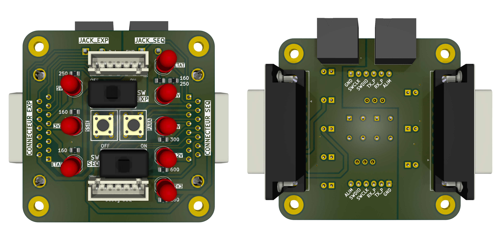
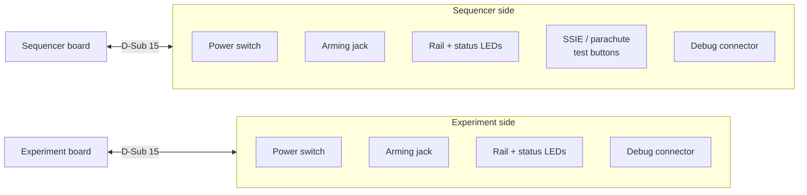

<p align="center">
  
</p>

# SCALAR-7 : IHM Bas

<p align="center">
  
  
  
</p>

HMI (Human-Machine Interface) board of the **lower stage** of **SCALAR-7**, a two-stage rocket launched at **C'Space 2026**.
It is the external control panel of the lower stage: it switches on, arms and monitors the **sequencer** and the **experiment** boards, and gives access to their debug ports without opening the rocket.

---
## Table of contents

- [Board features](#board-features)
- [Architecture](#architecture)
  - [Sequencer side](#sequencer-side)
  - [Experiment side](#experiment-side)
- [Main components](#main-components)
- [Repository structure](#repository-structure)

---

## Board features

| Function | Sequencer side | Experiment side |
|---|---|---|
| Board connection | D-Sub 15 (J2) | D-Sub 15 (J5) |
| Power switch | SPDT switch on the battery line (SW3) | SPDT switch on the battery line (SW4) |
| Arming | Arming jack connector (J1) | Arming jack connector (J4) |
| Status LEDs | 3V3, 5V, 6V, 12V rails + sequencer status | 3V3, 5V rails + experiment status |
| Debug | 6-pin connector for the Pico (SWD, UART, debug supply) (J3) | 6-pin connector for the Pico (SWD, UART, debug supply) (J6) |
| Test buttons | Parachute servo (SW2) and SSIE motor (SW1) | — |

---

## Architecture



The board has no microcontroller: it only routes signals and power. It is split into two independent halves, each with its own ground (`GND_SEQ` and `GND_EXP`), so the sequencer and the experiment stay electrically separated.

### Sequencer side

- **Power**: the sequencer's battery comes onto the HMI through the D-Sub connector and goes back through the power switch, which switches the sequencer on.
- **Arming**: the arming jack connector sends its state to a GPIO of the sequencer's Pico.
- **Status**: one LED per supply rail (3V3, 5V, 6V, 12V) and one status LED driven by the sequencer.
- **Tests**: two push buttons trigger the SSIE motor and the parachute servo for ground tests.
- **Debug**: a 6-pin connector gives access to the Pico's SWD, debug UART and debug supply.

### Experiment side

- **Power**: same principle as the sequencer side, with its own power switch.
- **Arming**: the arming jack connector sends its state to a GPIO of the experiment board's Pico.
- **Status**: one LED per supply rail (3V3, 5V) and one status LED driven by the experiment board.
- **Debug**: a 6-pin connector gives access to the Pico's SWD, debug UART and debug supply.

---

## Main components

| Ref. | Component | Function |
|---|---|---|
| J2, J5 | D-Sub 15 | Connection to the sequencer / experiment boards |
| SW3, SW4 | SPDT switches | Power switches |
| J1, J4 | 2-pin connectors | Arming jacks |
| J3, J6 | 6-pin connectors | Pico debug |
| SW1, SW2 | TE 1825910-6 | SSIE and parachute test buttons |
| D1–D8 | LEDs | Rail and status indicators |

---

## Repository structure

```
SCALAR-7_IHM_Bas/
├── hardware/          # KiCad project
├── images/
├── schematic.pdf
└── README.md
```

---